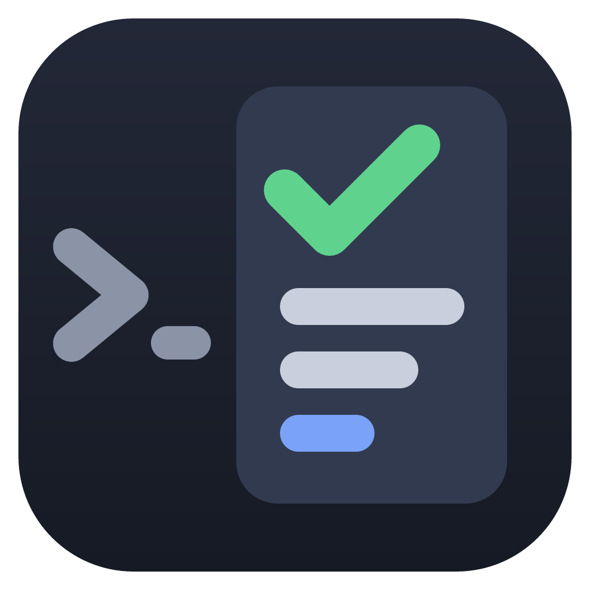

# claude-mods

Mods for [Claude Code](https://code.claude.com): plugins that change its interface.

## command-log



A pane beside the chat that shows the Bash commands Claude runs and what they print. See [its README](command-log/README.md) for how to use it and what it runs.

```
/plugin install command-log --marketplace jlhester/claude-mods
```

## License

MIT; see [LICENSE](LICENSE).
